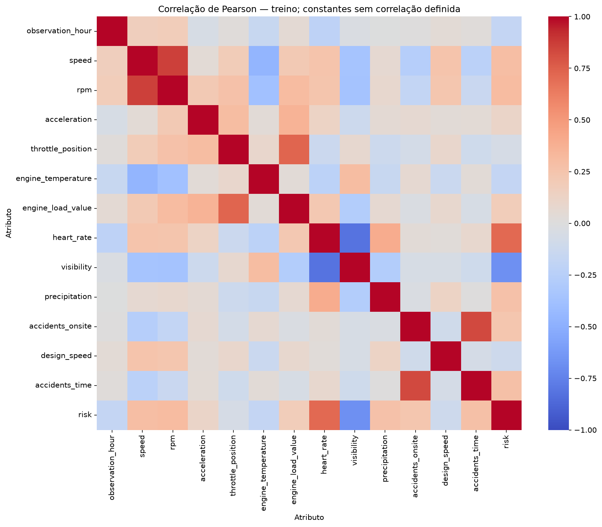
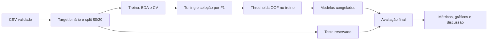
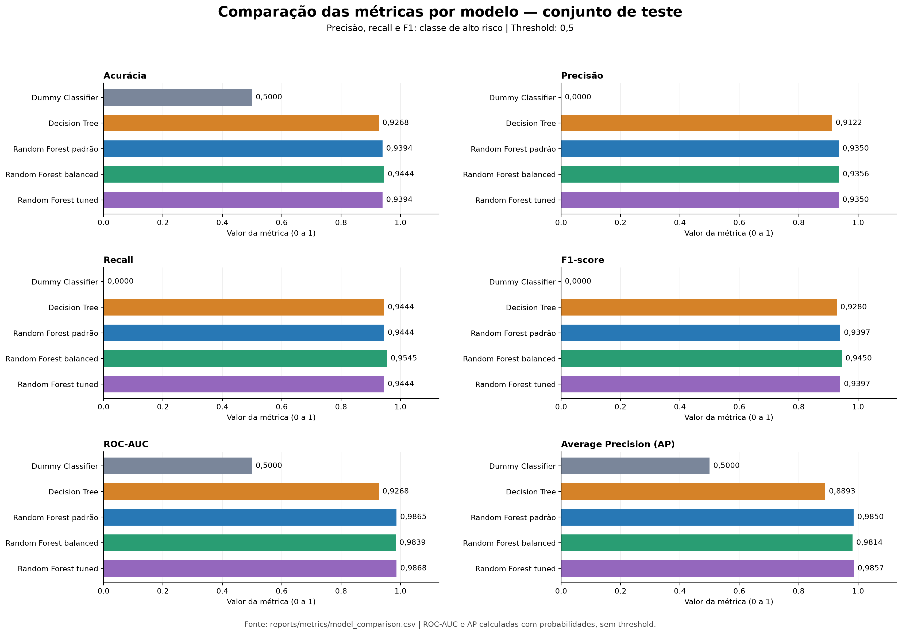
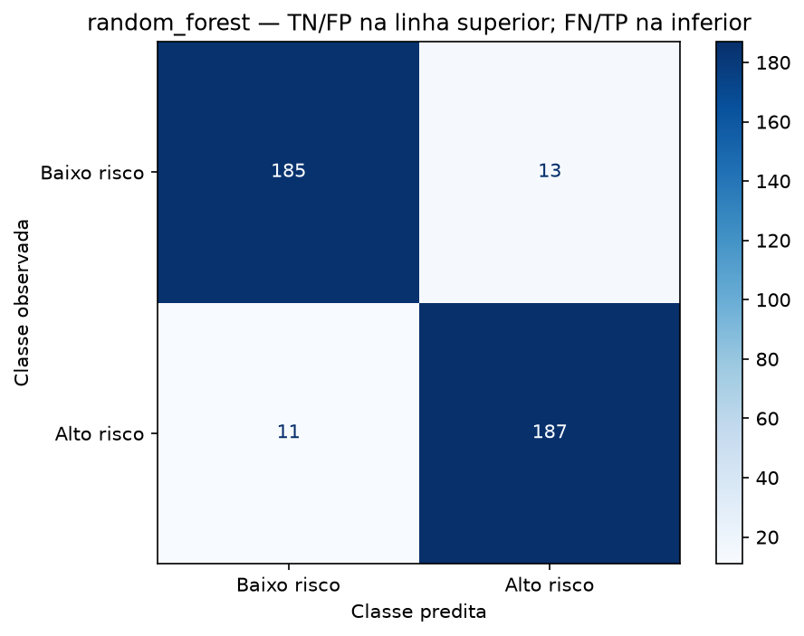
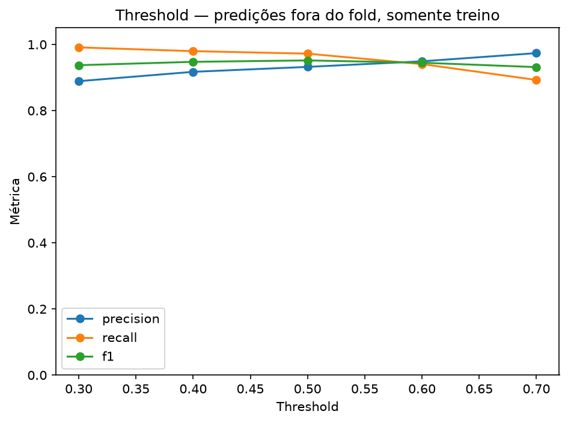
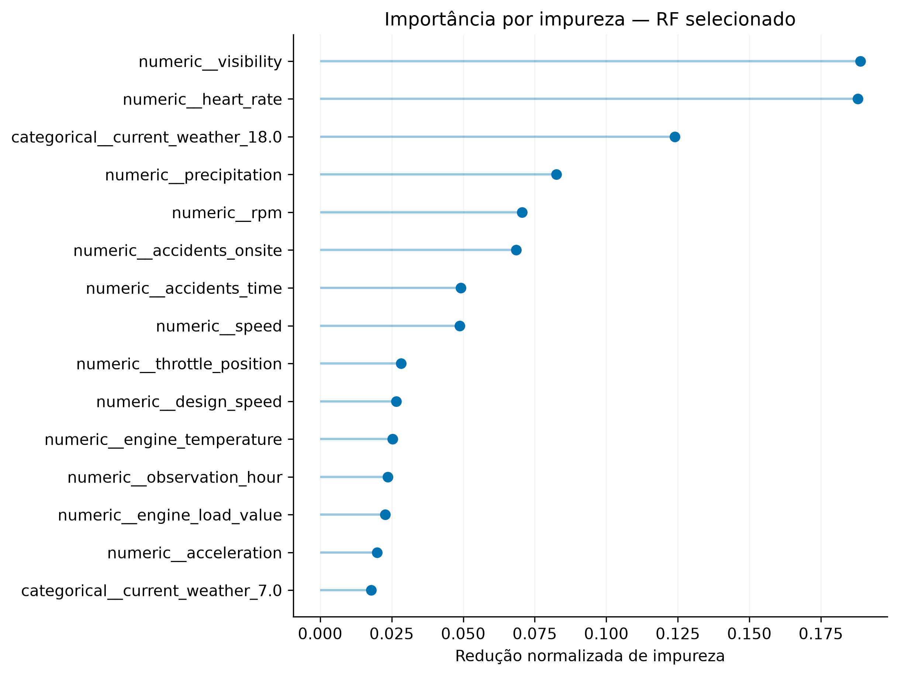
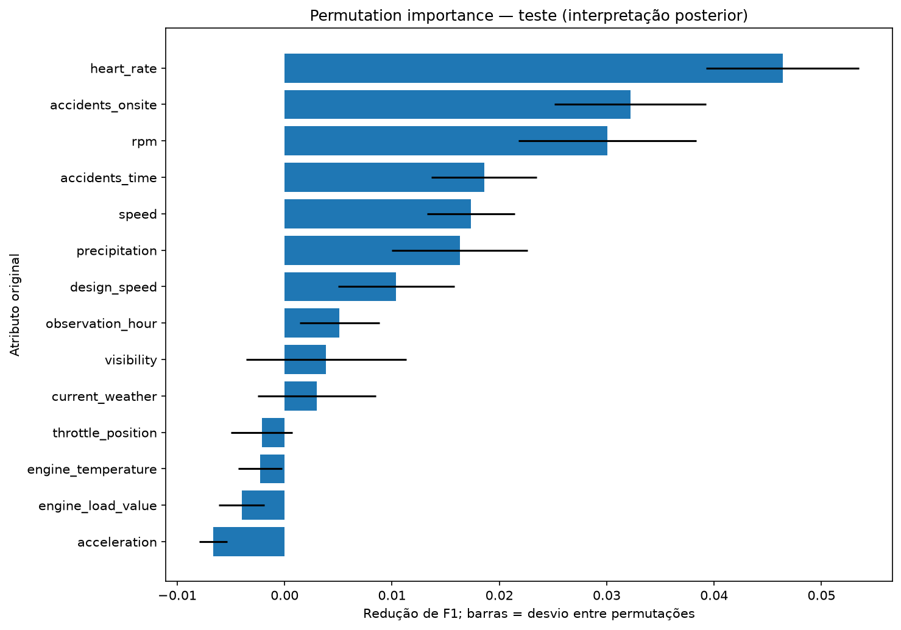

# Autonomous Driving Risk Detection using Random Forest

## Resumo

Este relatório apresenta um experimento de classificação de situações de risco na condução,
utilizando telemetria veicular, informações do motorista e características ambientais do
POLIDriving. Foram comparados Dummy Classifier, Decision Tree e três variantes de Random
Forest. O **RF padrão foi selecionado pelo F1 médio na validação de treino** e obteve,
no teste, acurácia de **0,9394**, recall de **0,9444** e F1 de **0,9397**. Apesar do ganho
sobre o baseline, os rótulos baseados em regras e a preparação sintética dos dados limitam
a interpretação: o experimento avalia classificação offline, não segurança veicular real.

Os números e gráficos abaixo são um **registro estático da execução concluída**, com
seed 42, cinco folds e 20 candidatos de tuning. As tabelas foram montadas a partir dos
CSVs gerados pelo código. As cópias em [docs/results](docs/results/) preservam as evidências
citadas, e o [manifesto](docs/results/manifest.json) registra versões, configuração e hashes.
Novos treinamentos atualizam `reports/`, mas não reescrevem este relatório ou seu snapshot.

## 1. Descrição do problema

Sistemas de assistência e condução autônoma precisam reconhecer condições que possam
exigir medidas preventivas. Neste trabalho, a pergunta de pesquisa é: **é possível
identificar situações rotuladas como de alto risco a partir de características do
veículo, do motorista e do ambiente?**

O modelo recebe 14 atributos e prevê uma classe binária: `0` para níveis baixo/médio e
`1` para níveis alto/muito alto. Essa simplificação concentra a análise em condições de
risco elevado. Classe 0 não equivale a uma situação comprovadamente segura.

Um falso positivo é um alerta em uma situação rotulada como baixo/médio risco; poderia
resultar em uma ação preventiva desnecessária. Um falso negativo é uma situação de
alto risco não detectada; poderia representar ausência de uma ação preventiva. Por isso,
a avaliação considera recall e F1, além da acurácia. O projeto não implementa controle do
veículo nem valida consequências físicas dessas decisões.

## 2. Dataset e análise exploratória

### 2.1. Fonte e recorte utilizado

Utilizamos o arquivo `labeled/20240208_120000_vld.csv` do
[repositório dos autores do POLIDriving](https://github.com/laboratorioAI/polidriving),
associado ao [artigo de Marcillo et al. (2024)](https://doi.org/10.3390/app14146300).
O download está fixado no commit `47238f96a18cb58733353cb647a0af99d4b4f0b5`.

O recorte possui **1.980 registros, 14 preditores e o target `risk_level`**, além de um
índice serializado descartado no carregamento. Não se deve confundir esse esquema com
os 32 atributos descritos para a base completa. O dicionário de dados, as unidades e o
mapeamento dos níveis estão detalhados em [docs/dataset.md](docs/dataset.md).

| Grupo | Atributos presentes no CSV |
|---|---|
| Telemetria do veículo | `speed`, `rpm`, `acceleration`, `throttle_position`, `engine_temperature`, `engine_load_value` |
| Motorista | `heart_rate` |
| Ambiente | `current_weather`, `visibility`, `precipitation` |
| Via e indicadores históricos | `accidents_onsite`, `design_speed`, `accidents_time` |
| Horário | `observation_hour` |

### 2.2. Target, balanceamento e qualidade

| Nível original | Interpretação | Target binário | Registros | Percentual |
|---|---|---|---:|---:|
| 1 / LOW | Baixo | 0 | 495 | 25% |
| 2 / MEDIUM | Médio | 0 | 495 | 25% |
| 3 / HIGH | Alto | 1 | 495 | 25% |
| 4 / VERY HIGH | Muito alto | 1 | 495 | 25% |

O agrupamento resulta em **990 exemplos por classe binária (50%)**. A inspeção do
DataFrame validado identificou **zero valores ausentes e zero duplicatas exatas**.
Mesmo assim, o pipeline suporta imputação para futuras entradas com ausências.
Fonte: [inspeção salva](docs/results/metrics/dataset_inspection.json).

O estudo original descreve rotulagem por regras/penalidades, inclusão de dados sintéticos
e reamostragem no processo mais amplo de preparação. O CSV utilizado não permite
identificar a proveniência de cada linha. Logo, o equilíbrio das classes não estima
a prevalência natural de risco e não exclui dependência entre exemplos.

### 2.3. Distribuições, relações e extremos

A EDA detalhada foi realizada **somente nas 1.584 amostras de treino**, mantendo as
396 amostras de teste reservadas. Algumas diferenças descritivas foram:

| Atributo (média no treino) | Classe 0 | Classe 1 |
| --- | --- | --- |
| Velocidade (km/h) | 57,65 | 76,54 |
| Frequência cardíaca (bpm) | 79,02 | 100,97 |
| Visibilidade (km) | 10,99 | 4,16 |

Fonte: [estatísticas por classe](docs/results/metrics/features_by_class.csv).
As situações rotuladas de alto risco apresentaram maior velocidade e frequência
cardíaca médias e menor visibilidade média. Essas associações descrevem o recorte e
podem refletir a construção dos rótulos; não demonstram causalidade.

A correlação de Pearson no treino foi aproximadamente **0,8617 entre velocidade e rpm**,
**−0,8162 entre frequência cardíaca e visibilidade** e **0,8286 entre os indicadores de
acidentes no local e por horário**. Essas relações sugerem redundâncias e características
específicas dos cenários amostrados.



Pelo critério de 1,5 vezes o IQR, 98 observações de aceleração (6,19%) e 369 de visibilidade
(23,30%) ficaram fora dos limites estatísticos no treino. Isso não significa erro de sensor:
distribuições assimétricas ou cenários distintos também produzem extremos. Nenhum outlier
foi removido automaticamente. Fonte: [análise de extremos](docs/results/metrics/outliers.csv).

## 3. Metodologia

### 3.1. Fluxo e prevenção de data leakage



O split usa `train_test_split(test_size=0.20, random_state=42, stratify=y)`, com
792 exemplos por classe no treino e 198 por classe no teste. O índice serializado
e o target nunca são preditores. Duplicatas exatas são verificadas antes da divisão.

Cada modelo está em um `Pipeline` com `ColumnTransformer`: mediana para ausências
numéricas, moda para `current_weather` e OneHotEncoder para seu código categórico.
O arredondamento determinístico desse código a seis casas reduz ruído decimal.
Não há normalização automática, pois árvores dividem atributos por limiares, nem
SMOTE adicional. Medianas, moda e categorias são aprendidas dentro de cada fold.

Essa separação evita que o código aprenda transformações a partir do teste, mas não
elimina possível contaminação herdada da preparação pública dos dados. O CSV não
fornece chaves para uma divisão independente por viagem ou motorista.

### 3.2. Modelos e seleção

| Modelo | Configuração e função no experimento |
|---|---|
| Dummy Classifier | `most_frequent`; referência que sempre prevê a classe majoritária |
| Decision Tree | Árvore individual com seed 42; baseline supervisionado |
| RF padrão | Floresta com parâmetros padrão e seed 42 |
| RF balanced | RF com `class_weight="balanced"` |
| RF tuned | Configuração escolhida por RandomizedSearchCV |

Os quatro modelos iniciais usam validação estratificada em cinco folds. A busca do tuned
avalia 20 combinações de `n_estimators`, `max_depth`, `min_samples_split`,
`min_samples_leaf`, `max_features`, `class_weight` e `bootstrap`, também em cinco folds.
A configuração vencedora da busca utiliza 400 árvores, `min_samples_split=5`,
`min_samples_leaf=2`, `max_features="sqrt"`, profundidade sem limite,
`class_weight="balanced"` e `bootstrap=False`.
Fonte: [parâmetros da busca](docs/results/metrics/best_parameters.json).

**Vencer a busca não garante ser o modelo final.** O maior F1 médio de CV entre os
três RF determina o pipeline salvo. Dummy e Decision Tree são referências de comparação.
O RF padrão venceu essa seleção. Os scores tuned são de seleção, sem CV aninhada,
e podem ser otimistas; diferenças pequenas não demonstram significância estatística.

### 3.3. Métricas e threshold

| Métrica | O que informa |
|---|---|
| Acurácia | Proporção global de classificações corretas |
| Precisão | Proporção de alto risco entre os alertas emitidos |
| Recall | Proporção de riscos rotulados que foram detectados |
| F1 | Média harmônica de precisão e recall; critério de seleção |
| ROC-AUC | Discriminação entre classes ao variar o limiar |
| Average Precision (AP) | Resumo da relação precision–recall calculado com probabilidades |

Precisão, recall e F1 se referem à classe `1`. Divisões indefinidas são registradas
como zero. O threshold final é **0,5**, com classe 1 quando `p >= 0,5`. A CV usa os
scorers baseados em `predict`, que podem tratar empates de probabilidade de forma
diferente. A avaliação de thresholds usa predições fora do fold (OOF) no treino,
sem selecionar um novo limiar a partir do teste. ROC-AUC e AP não dependem de um único
threshold. As probabilidades não foram calibradas para ocorrência de acidentes.

## 4. Resultados

Todos os valores desta seção vêm dos artefatos da execução, arredondados a quatro casas
decimais. DP significa desvio-padrão entre folds; não é intervalo de confiança.

### 4.1. Validação cruzada no treino

| Modelo | Acurácia ± DP | Precisão ± DP | Recall ± DP | F1 ± DP |
| --- | --- | --- | --- | --- |
| Dummy Classifier | 0,4987 ± 0,0006 | 0,1994 ± 0,2442 | 0,4000 ± 0,4899 | 0,2661 ± 0,3259 |
| Decision Tree | 0,9356 ± 0,0032 | 0,9348 ± 0,0129 | 0,9369 ± 0,0106 | 0,9357 ± 0,0029 |
| RF padrão | 0,9520 ± 0,0104 | 0,9350 ± 0,0182 | 0,9723 ± 0,0220 | 0,9530 ± 0,0102 |
| RF balanced | 0,9457 ± 0,0108 | 0,9330 ± 0,0130 | 0,9609 ± 0,0259 | 0,9464 ± 0,0112 |
| RF tuned | 0,9520 ± 0,0067 | 0,9413 ± 0,0140 | 0,9647 ± 0,0216 | 0,9526 ± 0,0070 |

Fonte: [cv_summary.csv](docs/results/metrics/cv_summary.csv).
O F1 médio de **0,9530 do RF padrão** foi ligeiramente superior ao **0,9526 do tuned**.
A diferença sem arredondamento é cerca de 0,0004 e não estabelece superioridade
estatística. O critério previamente definido, contudo, seleciona o padrão.

O Dummy apresenta F1 variável entre folds porque pequenas diferenças de contagem
mudam a classe majoritária. Ajustado sobre todo o treino balanceado, escolhe a classe 0;
por isso seu F1 final no teste é zero.

### 4.2. Comparação no conjunto de teste

| Modelo | Acurácia | Precisão | Recall | F1 | ROC-AUC | AP |
| --- | --- | --- | --- | --- | --- | --- |
| Dummy Classifier | 0,5000 | 0,0000 | 0,0000 | 0,0000 | 0,5000 | 0,5000 |
| Decision Tree | 0,9268 | 0,9122 | 0,9444 | 0,9280 | 0,9268 | 0,8893 |
| RF padrão | 0,9394 | 0,9350 | 0,9444 | 0,9397 | 0,9865 | 0,9850 |
| RF balanced | 0,9444 | 0,9356 | 0,9545 | 0,9450 | 0,9839 | 0,9814 |
| RF tuned | 0,9394 | 0,9350 | 0,9444 | 0,9397 | 0,9868 | 0,9857 |

Fonte: [model_comparison.csv](docs/results/metrics/model_comparison.csv).



[Versão vetorial em PDF do gráfico comparativo](docs/results/figures/11_model_comparison.pdf).

Gráficos individuais em PNG:

- [Acurácia](docs/results/figures/11_model_comparison_accuracy.png)
- [Precisão](docs/results/figures/11_model_comparison_precision.png)
- [Recall](docs/results/figures/11_model_comparison_recall.png)
- [F1-score](docs/results/figures/11_model_comparison_f1.png)
- [ROC-AUC](docs/results/figures/11_model_comparison_roc_auc.png)
- [Average Precision (AP)](docs/results/figures/11_model_comparison_average_precision.png)

O **RF balanced teve o maior F1 pontual no teste (0,9450)** e o maior recall (0,9545).
O RF padrão permanece como modelo selecionado, pois trocar a escolha com base nesses
resultados utilizaria o teste como validação. O tuned igualou acurácia, precisão,
recall e F1 do padrão, com pequena diferença em ROC-AUC e AP, que usam probabilidades.

### 4.3. Matriz de confusão e erros do RF selecionado

| Classe observada | Predito baixo/médio | Predito alto/muito alto |
|---|---:|---:|
| Baixo/médio risco | 185 (TN) | 13 (FP) |
| Alto/muito alto risco | 11 (FN) | 187 (TP) |



Dos 198 exemplos de alto risco, **11 não foram detectados**, correspondendo a 5,56%.
Dos 200 alertas emitidos, 13 foram falsos positivos. Em comparação com a árvore individual,
o RF padrão manteve os mesmos 11 FN e reduziu os FP de 18 para 13: seu ganho de F1
neste teste veio de menos alertas incorretos, sem aumento de recall.
O balanced registrou 9 FN e 13 FP. Essa diferença descritiva exige validação independente
antes de motivar uma mudança de modelo.

### 4.4. Treino versus teste

| Modelo | F1 treino | F1 teste | Diferença F1 | Recall treino | Recall teste |
| --- | --- | --- | --- | --- | --- |
| Decision Tree | 1,0000 | 0,9280 | 0,0720 | 1,0000 | 0,9444 |
| RF padrão | 1,0000 | 0,9397 | 0,0603 | 1,0000 | 0,9444 |
| RF balanced | 1,0000 | 0,9450 | 0,0550 | 1,0000 | 0,9545 |
| RF tuned | 0,9987 | 0,9397 | 0,0590 | 0,9975 | 0,9444 |

Fonte: [train_test_comparison.csv](docs/results/metrics/train_test_comparison.csv).
A árvore e os RF padrão/balanced atingiram F1 e recall perfeitos no treino, com queda
no teste. Há indícios de sobreajuste e uma diferença de generalização: no RF padrão,
a queda de F1 foi 0,0603 e a de recall foi 0,0556. O tuned reduziu ligeiramente o ajuste
perfeito ao treino, mas não melhorou seu F1 de teste. Essa leitura considera várias
métricas; não é um diagnóstico baseado apenas em acurácia.

### 4.5. Análise de thresholds no treino

A tabela seguinte usa **1.584 predições OOF do treino**, não as 396 amostras do teste.

| Threshold | Precisão | Recall | F1 | FP | FN |
| --- | --- | --- | --- | --- | --- |
| 0,30 | 0,8890 | 0,9912 | 0,9373 | 98 | 7 |
| 0,40 | 0,9173 | 0,9798 | 0,9475 | 70 | 16 |
| 0,50 | 0,9322 | 0,9722 | 0,9518 | 56 | 22 |
| 0,60 | 0,9490 | 0,9407 | 0,9448 | 40 | 47 |
| 0,70 | 0,9738 | 0,8927 | 0,9315 | 19 | 85 |

Fonte: [threshold_analysis.csv](docs/results/metrics/threshold_analysis.csv).



Reduzir o threshold de 0,5 para 0,3 diminuiu os FN de 22 para 7, mas aumentou os FP de
56 para 98. O recall subiu de 0,9722 para 0,9912 e a precisão caiu de 0,9322 para 0,8890.
Esse resultado evidencia o compromisso entre detectar mais riscos e emitir mais alertas.
Como a configuração do RF foi selecionada no mesmo treino, a análise OOF é exploratória;
o threshold final permaneceu 0,5.

### 4.6. Importância dos atributos



A importância por impureza destacou **visibilidade (0,1888)**, **frequência cardíaca
(0,1878)** e o indicador one-hot do **código meteorológico 18 (0,1239)**. O código 18
não recebe interpretação semântica adicional, pois seu significado não foi validado.



A permutação, com dez repetições no teste, colocou **frequência cardíaca** em primeiro
lugar (queda média de F1 de 0,0464 ± 0,0071), seguida de **acidentes no local**
(0,0322 ± 0,0071) e **rpm** (0,0300 ± 0,0083). A visibilidade teve queda média de apenas
0,0039 ± 0,0075. As fontes são as tabelas de
[impureza](docs/results/metrics/feature_importance.csv) e
[permutação](docs/results/metrics/permutation_importance.csv).

Os rankings não são diretamente equivalentes: impureza considera atributos transformados,
enquanto permutação atua sobre as features originais. A forte correlação entre frequência
cardíaca e visibilidade pode contribuir para compartilhar informação e reduzir a perda
quando uma delas é permutada. Isso é uma interpretação possível, não uma causa demonstrada.
Valores negativos de permutação indicam que, nessa avaliação, embaralhar o atributo
melhorou o F1; não justificam removê-lo e voltar a ajustar usando o mesmo teste.

## 5. Discussão crítica

### 5.1. Acurácia e relevância dos falsos negativos

O Dummy obteve acurácia de 50% sem detectar nenhum dos 198 exemplos de alto risco.
Esse baseline mostra que uma taxa global de acertos pode ocultar um comportamento
inadequado para a finalidade do projeto. O RF padrão superou essa referência, mas seus
11 falsos negativos continuam relevantes. Um recall de 0,9444 não constitui garantia
de segurança, e o custo de um erro depende do contexto de uso, não definido aqui.

PR e AP complementam ROC-AUC porque evidenciam a qualidade dos alertas e a cobertura da
classe positiva. A prevalência de alto risco neste teste é 50%, inclusive explicando a
AP de 0,5 do Dummy. Se essa prevalência mudar em uso real, a precisão e a referência da
curva PR também poderão mudar; não se deve transferir diretamente esses valores.

### 5.2. Tuning, balanceamento e estabilidade

A busca não trouxe ganho de F1 no teste para o RF tuned. A diferença de ROC-AUC em relação
ao padrão foi aproximadamente 0,0003, insuficiente para sustentar ganho prático por si só.
Mais árvores e ajustes adicionais não garantem melhor generalização; o resultado também
é condicionado ao espaço e às 20 configurações pesquisadas.

Apesar do equilíbrio global das classes, folds podem ter pequenas diferenças de contagem.
O RF balanced apresentou o melhor resultado pontual no teste, mas uma média de F1 menor
na CV. Assim, não há evidência consistente para declarar que ponderar classes foi superior.
Não foram realizados testes de significância ou validação externa, e a CV usada na seleção
não fornece uma estimativa independente do desempenho do vencedor.

### 5.3. Confronto das hipóteses

| Hipótese | Leitura dos resultados desta execução |
|---|---|
| H1 — RF distingue situações de risco | Há evidência de classificação dos rótulos publicados acima do Dummy; isso não demonstra previsão de acidentes reais. |
| H2 — RF supera uma árvore individual | O padrão melhorou F1 de teste em cerca de 0,0117 e apresentou maior F1 médio de CV; o recall de teste foi igual. Superioridade estatística não foi demonstrada. |
| H3 — Tuning melhora generalização | Não sustentada pelo F1 de teste desta busca, que permaneceu igual ao padrão. |
| H4 — Algumas features são mais importantes | Os rankings diferem e destacam atributos, especialmente frequência cardíaca; não foi testada significância nem causalidade dessas importâncias. |
| H5 — Acurácia isolada é insuficiente | O Dummy e a análise de thresholds ilustram limitações da acurácia e o trade-off de erros; não foi conduzida uma busca paralela otimizada apenas por acurácia. |

### 5.4. Limitações e validade externa

A principal limitação é a **origem dos rótulos e das amostras**. Regras de rotulagem
podem depender dos mesmos atributos usados pelo modelo. Um bom classificador pode
estar reconstruindo essas regras, sem aprender a antecipar acidentes observados.
Exemplos sintéticos e eventual reamostragem anterior ao split podem produzir similaridades
entre treino e teste que o pipeline local não consegue auditar.

Além disso, o CSV não identifica viagens, motoristas ou a origem natural/sintética de
cada linha. O split aleatório não garante independência temporal. Os cenários são
restritos geograficamente, e o recorte é pequeno para representar cidades, climas,
veículos e condições de trânsito diversos. Ausência de dados faltantes no arquivo
preparado não demonstra ausência de falhas de sensores em campo.

Não há câmera/LiDAR neste recorte, nem avaliação temporal completa, prospectiva ou em
malha fechada. A relevância da frequência cardíaca também limita a transferência do
experimento para um veículo sem motorista humano. Mudanças de distribuição e a
disponibilidade dos indicadores históricos no momento da previsão exigem análise própria.

## 6. Conclusão

O Random Forest mostrou capacidade de reproduzir os rótulos binários do recorte POLIDriving
com desempenho superior ao baseline trivial. O padrão foi selecionado pelo protocolo de
validação e alcançou F1 de 0,9397 no teste; o ganho sobre a árvore individual veio da
redução de falsos positivos. O tuning não trouxe ganho de F1, e o melhor resultado
pontual do balanced no teste não alterou a seleção feita no treino.

O experimento oferece evidências úteis para um trabalho acadêmico sobre classificação,
mas não valida uso direto em veículos reais. Os próximos estudos devem investigar os
falsos negativos de forma descritiva e obter dados com proveniência e viagens independentes
para uma nova validação, realizada antes de qualquer reamostragem. A escolha de modelo
ou threshold operacional requer critérios de custo e segurança que este estudo não definiu.

## Documentação complementar

- [Fluxo detalhado do pipeline](docs/pipeline.md): funções, comandos e artefatos de cada etapa.
- [Dataset e contrato de entrada](docs/dataset.md): atributos, unidades e proveniência.
- [Metodologia](docs/methodology.md): protocolo, hipóteses e limitações.
- [Evidências desta execução](docs/results/): gráficos, métricas e manifesto do relatório.

## Estrutura

O [guia detalhado do pipeline](docs/pipeline.md) explica a ordem de execução, as funções
envolvidas, a separação treino/teste, a seleção do modelo e os artefatos gerados.

```text
data/{raw,processed}/   CSV original e split reproduzível
notebooks/             EDA, pré-processamento, treino, avaliação
src/
  config.py            Seed, esquema e parâmetros centrais
  data_loader.py       Download, validação e inspeção
  features.py          Separação explícita dos preditores e target
  preprocessing.py     ColumnTransformer e Pipeline
  eda.py               Análises e gráficos do treino
  train.py             Baselines, CV e tuning
  evaluate.py          Métricas, curvas, importâncias e conclusão
  predict.py           Inferência em novas amostras
  utils.py             Persistência e hash
models/                Pipelines e metadados da execução
reports/{figures,metrics}/
docs/                  Dataset e protocolo metodológico
tests/                 Testes de dados, pré-processamento e avaliação
```

## Instalação

Python 3.11 ou superior. Na raiz do repositório:

```bash
python3 -m venv .venv
source .venv/bin/activate
python -m pip install -r requirements.txt
```

`requirements.txt` define faixas compatíveis; `requirements-lock.txt` registra o ambiente
usado nesta implementação (Python 3.14). Para reproduzi-lo na mesma versão de Python,
use `python -m pip install -r requirements-lock.txt`. Versões efetivas são gravadas
em `models/metadata.json` a cada treino.

## Execução

```bash
# Download público fixado em commit, com verificação SHA-256
python -m src.data_loader

# Fluxo completo: inspeção, EDA, CV, tuning, avaliação e modelo salvo
python -m src.train

# Regerar avaliação dos modelos/split salvos, sem novo treinamento
python -m src.evaluate

# Testes
python -m pytest -q

# Notebooks: executar na ordem 01 → 04, usando o Python da .venv
jupyter lab
```

Também é possível baixar o CSV pelo link no repositório dos autores e colocá-lo em
`data/raw/`. Para outro nome com **o mesmo esquema**:

```bash
python -m src.train --data data/raw/meu_arquivo.csv --iterations 20 --folds 5 --jobs 1
```

`--output /caminho/execucao` separa os artefatos de experimentos distintos; por padrão,
novas execuções atualizam os artefatos gerados na raiz. `--train-only` adia a avaliação.
`--jobs -1` permite usar todos os núcleos, se houver recursos. Dados e modelos não são
versionados. Download e dependências precisam de rede; depois o fluxo funciona offline.
Não é necessário copiar dados para dentro dos notebooks.

## Inferência

Prepare um CSV com cabeçalho e as 14 features descritas em `docs/dataset.md`, sem precisar
do target ou índice. A função valida o esquema e usa o pipeline salvo completo:

```bash
python -m src.predict data/raw/novas_amostras.csv --output reports/predictions.csv
```

A saída contém `prediction`, `label` e `probability_high_risk`. Probabilidade refere-se
ao rótulo do dataset, não à ocorrência de acidente. Threshold fixado em 0,5. Arquivos
joblib devem vir de uma fonte confiável, pois sua leitura executa desserialização Python.
