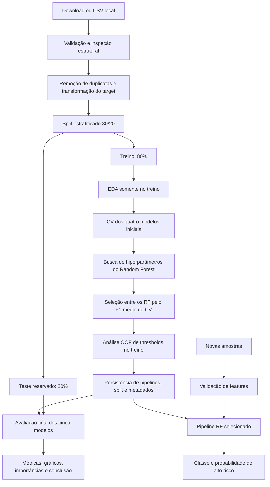
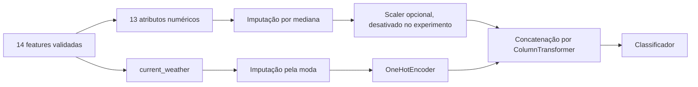

# Fluxo de execução e pipeline do projeto

Este documento descreve o comportamento implementado no código: como o CSV se transforma
em modelos, avaliações e previsões. Para o significado dos atributos, consulte
[Dataset](dataset.md); para hipóteses e justificativas científicas, consulte
[Metodologia](methodology.md).

Há dois sentidos para a palavra **pipeline** neste projeto. O fluxo do experimento
inclui carregamento, separação dos dados, exploração, treinamento e avaliação.
Já o objeto `sklearn.pipeline.Pipeline` reúne o pré-processamento aprendido e um
classificador, garantindo que as mesmas transformações sejam aplicadas às novas amostras.

## 1. Visão geral



A seleção termina antes da avaliação do teste. As importâncias calculadas posteriormente
não alimentam outro treinamento. O download é uma etapa separada: `src.train` exige que
o arquivo já exista.

## 2. Como executar

Execute os comandos a partir da raiz do repositório, com as dependências instaladas
conforme o [README](../README.md).

```bash
source .venv/bin/activate
python -m src.data_loader
python -m src.train
```

O primeiro módulo obtém os dados; o segundo executa todo o experimento, incluindo a
avaliação final. Para separar treinamento e avaliação:

```bash
python -m src.train --train-only
python -m src.evaluate
```

Para manter outra execução em uma pasta própria:

```bash
python -m src.train --data data/raw/20240208_120000_vld.csv \
  --output runs/experimento_01 --folds 5 --iterations 20 --jobs 1 --train-only
python -m src.evaluate --output runs/experimento_01
```

`--output` define a raiz dos artefatos, não a localização do CSV. Ao usar uma pasta
alternativa, informe a mesma pasta na avaliação. A pasta `runs/` deste exemplo não
está coberta pelas regras atuais de `.gitignore`; evite versionar seus dados e modelos
inadvertidamente. Reexecutar na mesma raiz atualiza arquivos gerados. `--train-only`
não apaga avaliações antigas: até executar `src.evaluate`, elas podem ser de um treino
anterior. Prefira uma pasta nova para experimentos que precisam ser comparados.

## 3. Configuração e ponto de entrada

O comando `python -m src.train` constrói um `ExperimentConfig` e chama
`run_training(config, evaluate=True)` em [src/train.py](../src/train.py).

| Configuração | Padrão | Como alterar |
|---|---|---|
| Arquivo | `data/raw/20240208_120000_vld.csv` | `--data` |
| Raiz dos artefatos | Raiz do repositório | `--output` |
| Seed | `42` | `ExperimentConfig(seed=...)` em Python |
| Fração de teste | `0.20` | `ExperimentConfig(test_size=...)` em Python |
| Folds | `5` | `--folds` |
| Candidatos da busca | `20` | `--iterations` |
| Paralelismo de CV/busca | `1` | `--jobs` |
| Avaliação ao fim do treino | Ativada | `--train-only` para adiar |

A seed, o esquema das features, o target e a referência do download estão em
[src/config.py](../src/config.py). O código rejeita configurações básicas inválidas,
como menos de dois folds, nenhuma iteração ou `jobs=0`. Os classificadores RF usam
`n_jobs=1`; o paralelismo configurável fica no nível da validação e da busca.

## 4. Obtenção, carregamento e validação

**Responsáveis:** `download_data()`, `load_data()`, `validate_features()` e
`inspect_data()` em [src/data_loader.py](../src/data_loader.py).

`download_data()` baixa o CSV de uma revisão fixa do repositório POLIDriving e verifica
seu SHA-256. Se o destino já existir com o hash esperado, apenas retorna seu caminho;
se diferir, interrompe sem sobrescrevê-lo. Um arquivo fornecido por `--data` não precisa
ter o hash oficial: o treinamento registra seu hash e valida seu esquema.

`load_data()` lê o CSV com pandas e exige registros, as 14 features e `risk_level`.
Somente a coluna adicional `Unnamed: 0`, correspondente ao índice serializado, é
aceita e descartada. Outras colunas extras interrompem o carregamento de treino.

As features são selecionadas na ordem de `FEATURES` e convertidas para números.
Valores infinitos e conteúdo não numérico provocam erro; ausências são permitidas
para posterior imputação. O código meteorológico continua sendo tratado como categoria
no modelo, embora sua representação no CSV seja numérica. Ele é arredondado a seis
casas para reduzir ruído decimal, sem aprender estatísticas da amostra.

A inspeção global registra shape, head/tail, informações de tipos, estatísticas,
ausências, duplicatas e distribuição das classes em
`reports/metrics/dataset_inspection.json`. Ela ocorre sobre o DataFrame validado,
após descartar o índice e ajustar os códigos meteorológicos. Essa inspeção é estrutural;
a exploração detalhada que poderia orientar decisões utiliza somente o treino.

## 5. Target, duplicatas e separação dos dados

**Responsáveis:** `prepare_data()` em [src/train.py](../src/train.py) e
`split_features_target()` em [src/features.py](../src/features.py).

Após a inspeção, `drop_duplicates()` remove linhas idênticas do DataFrame validado,
incluindo o target original. Os índices pandas das linhas restantes são preservados.
Isso não identifica exemplos aproximadamente iguais nem parentesco entre amostras
sintéticas. Duas linhas com features iguais e targets originais diferentes não são
eliminadas por essa regra.

`split_features_target()` produz:

| Objeto | Conteúdo |
|---|---|
| `X` | As 14 features, sem target ou índice serializado |
| `y` | Série binária chamada `risk` |

A transformação do target usa `transform_target()`:

| Target original | Target usado pelo modelo |
|---|---|
| `1` ou `LOW` | `0` |
| `2` ou `MEDIUM` | `0` |
| `3` ou `HIGH` | `1` |
| `4` ou `VERY HIGH` | `1` |

Espaços externos, letras minúsculas e representações como `1.0` são normalizados.
Targets ausentes ou desconhecidos são rejeitados. A função não recebe um dataset já
binário como alternativa automática: `0` não é um nível original aceito. Classe 0
inclui risco médio, portanto não significa garantia de segurança.

A divisão usa `train_test_split(test_size=0.20, random_state=42, stratify=y)`.
O resultado contém `X_train`, `X_test`, `y_train` e `y_test`. Para o arquivo de 1.980
registros sem duplicatas, são 1.584 amostras de treino e 396 de teste. Outros arquivos
podem produzir quantidades diferentes.

O código verifica a presença das duas classes e a disponibilidade de amostras para
os folds; o próprio split também pode rejeitar tamanhos incompatíveis. Índices,
contagem de duplicatas removidas, classes, seed e hash são registrados em
`reports/metrics/split.json`. O objeto completo do split permanece em memória e será
salvo ao concluir o treinamento.

## 6. Análise exploratória do treino

**Responsável:** `run_eda()` em [src/eda.py](../src/eda.py).

O DataFrame passado à EDA é `frame.loc[X_train.index]`. A análise abrange distribuição
das classes, ausências, histogramas numéricos, correlações, boxplots por classe,
assimetria e extremos identificados por IQR. Também produz médias, medianas e desvios
por classe. Features constantes podem ter correlações indefinidas.

A EDA salva os gráficos `01` a `04` e `12`, além das tabelas descritivas. Ela não altera
os preditores escolhidos, não remove outliers e não ajusta o imputador. Extremos podem
representar justamente situações de risco.

## 7. Pipeline de pré-processamento e classificador

**Responsáveis:** `make_preprocessor()` e `make_pipeline()` em
[src/preprocessing.py](../src/preprocessing.py).



O `ColumnTransformer` recebe listas explícitas de colunas e descarta o restante.
`OneHotEncoder(handle_unknown='ignore', sparse_output=False)` cria indicadores para
as categorias aprendidas; uma categoria nova não provoca erro de transformação.
Os imputadores preservam colunas inteiramente ausentes no treino por meio de
`keep_empty_features=True`. `scale=True` habilita StandardScaler no ramo numérico,
mas o fluxo atual de Random Forest usa `scale=False`.

O Pipeline possui dois passos: `preprocess` e `model`. Em cada fold, um clone é
ajustado apenas na parte usada para treinar aquele fold. Medianas, moda e categorias
não são aprendidas a partir da parte de validação. Na avaliação e na inferência,
utiliza-se o pré-processamento já ajustado, sem chamar `fit` novamente.

A validação de esquema e o arredondamento meteorológico ficam **fora** desse Pipeline,
em `validate_features()`. Por isso, a interface recomendada de inferência é
`predict_samples()` ou o comando `src.predict`, que executa essa etapa antes de chamar
o modelo salvo.

## 8. Baselines e validação cruzada

**Responsável:** `run_training()`.

São construídos inicialmente quatro pipelines:

| Identificador | Método | Papel |
|---|---|---|
| `dummy` | DummyClassifier, `most_frequent` | Referência que sempre escolhe a classe majoritária |
| `decision_tree` | DecisionTreeClassifier | Comparação com uma árvore individual |
| `random_forest` | RandomForestClassifier padrão | Modelo principal sem tuning |
| `random_forest_balanced` | RF com `class_weight='balanced'` | Comparação com ponderação automática das classes |

Cada um é avaliado por `cross_validate()` com
`StratifiedKFold(n_splits=5, shuffle=True, random_state=42)`. Em cada rodada, quatro
folds treinam e o restante valida; todas as amostras de treino participam uma vez da
validação. O teste reservado não participa desse processo.

São calculados accuracy, precision, recall e F1. Precision, recall e F1 referem-se à
classe positiva `1`, usando `zero_division=0`. Médias e desvios usam os resultados dos
folds; o desvio é calculado com `numpy.std`, sem correção amostral. Após sua CV, cada
pipeline inicial é ajustado novamente sobre todo `X_train` para a avaliação posterior.

O Dummy também recebe o mesmo pipeline, mas não usa relações entre features e target
para decidir. Sua classe majoritária é determinada em cada ajuste; pode variar entre
folds quando as contagens são muito próximas.

## 9. Busca de hiperparâmetros

**Responsável:** `RandomizedSearchCV` dentro de `run_training()`.

A busca avalia 20 combinações sorteadas com seed 42, cada uma nos mesmos cinco folds.
Os parâmetros pertencem ao passo `model` do Pipeline, por isso seus nomes começam com
`model__`.

| Parâmetro | Valores candidatos |
|---|---|
| `n_estimators` | `100`, `200`, `400` |
| `max_depth` | `None`, `5`, `10`, `20` |
| `min_samples_split` | `2`, `5`, `10` |
| `min_samples_leaf` | `1`, `2`, `4` |
| `max_features` | `'sqrt'`, `'log2'`, `0.8` |
| `class_weight` | `None`, `'balanced'` |
| `bootstrap` | `True`, `False` |

A busca calcula as quatro métricas, mas `refit='f1'` determina a configuração vencedora.
O pipeline vencedor é ajustado em todo o treino e recebe o identificador
`random_forest_tuned`. `return_train_score=True` registra também scores de treino
por candidato em `search_results.csv`.

O arquivo `best_parameters.json` contém **os parâmetros vencedores da busca tuned**.
Ele não necessariamente descreve o RF finalmente salvo para inferência: a etapa
seguinte ainda compara tuned, padrão e balanced.

## 10. Seleção do Random Forest final

A seleção considera apenas `random_forest`, `random_forest_balanced` e
`random_forest_tuned`, escolhendo o maior `f1_mean` de CV. Dummy e Decision Tree são
referências de comparação, não candidatos ao arquivo `random_forest_best.joblib`.
Em empate exato, `idxmax()` retorna o primeiro na ordem: padrão, balanced, tuned.

O identificador selecionado é registrado em `models/metadata.json` e
`models/experiment.joblib`. Consultar esses arquivos é a forma correta de descobrir
qual RF foi salvo, em vez de inferir isso pela tabela de teste ou pelos parâmetros
da busca.

A CV da configuração tuned foi usada para escolhê-la e pode ser otimista; não é CV
aninhada. As médias dos outros modelos também participam da seleção entre RF. O teste
fica reservado para avaliar o resultado dessa escolha. Se outra variante apresentar
F1 maior no teste, ela não substitui automaticamente o pipeline selecionado.

## 11. Análise de thresholds com predições fora do fold

**Responsáveis:** `cross_val_predict()` em `run_training()` e `threshold_analysis()`
em [src/evaluate.py](../src/evaluate.py).

Depois de selecionar o RF, o código usa clones de sua configuração para obter uma
probabilidade por amostra de treino, sempre prevista por um ajuste que não usou aquela
amostra. São predições *out-of-fold* (OOF). O pipeline já ajustado em todo o treino
continua disponível para persistência.

Para cada threshold `0.30`, `0.40`, `0.50`, `0.60` e `0.70`, aplica-se:

```text
probabilidade de alto risco >= threshold → classe 1
probabilidade de alto risco <  threshold → classe 0
```

A tabela registra métricas e contagens de erros; o gráfico mostra precision, recall e
F1. ROC-AUC e AP na tabela dependem das mesmas probabilidades e não mudam com o threshold.
Os arquivos são `oof_predictions.csv`, `threshold_analysis.csv` e
`10_threshold_analysis.png`.

A análise é exploratória: a configuração foi selecionada usando o mesmo conjunto de
treino. O threshold final permanece `0.5`, sem otimização automática. Na CV, scorers
padrão usam `predict`; na avaliação e inferência usa-se explicitamente `p >= 0.5`.
Essas regras podem divergir em empates exatos de probabilidade.

## 12. Persistência e rastreabilidade

Ao concluir o treino e a análise de thresholds, o código salva:

| Arquivo | Conteúdo | Consumidor |
|---|---|---|
| `data/processed/split.joblib` | Dados separados, índices e hash do CSV | Avaliação |
| `models/experiment.joblib` | Cinco pipelines, identificador selecionado, threshold, seed, features e referência do treino | Avaliação |
| `models/random_forest_best.joblib` | Pipeline completo do RF selecionado | Inferência |
| `models/metadata.json` | Modelo escolhido, configuração, versões, features, threshold e hash | Auditoria da execução |

Os dados de `split.joblib` ainda estão na representação validada das features,
**não** em uma matriz globalmente imputada ou codificada. Cada pipeline aplica seu
próprio pré-processamento. O arquivo `random_forest_best.joblib` não contém apenas
a floresta: inclui o `ColumnTransformer` ajustado.

A seed contribui para repetibilidade, enquanto hash, versões e configurações permitem
identificar o experimento. Mesma seed não garante resultados idênticos entre versões
diferentes das bibliotecas. Os arquivos gerados nas pastas padrão são ignorados pelo Git.

## 13. Avaliação final

**Responsável:** `evaluate_artifacts()` em [src/evaluate.py](../src/evaluate.py).

Essa função roda automaticamente ao final de `src.train`, exceto com `--train-only`.
Também pode ser chamada isoladamente por `python -m src.evaluate`.

Ela carrega `experiment.joblib` e `split.joblib` e compara o hash registrado dos dados
e os índices de treino. Uma divergência interrompe a avaliação. Essa verificação não
reabre o CSV original nem constitui uma verificação completa de integridade de todos
os artefatos.

Para cada um dos cinco modelos, calcula probabilidades sobre treino e teste e aplica
threshold `0.5`. `binary_metrics()` produz accuracy, precision, recall, F1, ROC-AUC,
Average Precision e as contagens TN, FP, FN e TP. Os relatórios por classe incluem
precision, recall, F1 e suporte.

| Resultado | Uso |
|---|---|
| `train_test_comparison.csv` | Comparar treino e teste e investigar sobreajuste |
| `model_comparison.csv` | Comparar os cinco modelos apenas no teste |
| `classification_reports.json` | Examinar métricas de cada classe e conjunto |
| Gráfico `11_model_comparison`, PNG/PDF | Comparar seis métricas com valores anotados |

A matriz de confusão e as curvas ROC/PR representam **o RF selecionado**, enquanto o
gráfico comparativo inclui os cinco modelos. Reexecutar a avaliação não faz tuning,
não recalcula a EDA e não seleciona outro modelo.

## 14. Importâncias e conclusão automática

`importance_plots()` calcula duas análises para o RF selecionado. A importância por
impureza vem da floresta treinada e usa nomes das features transformadas, incluindo
colunas one-hot. A importância por permutação usa as 14 features originais do teste,
com dez repetições e redução de F1 como critério. Não é necessário que os dois rankings
coincidam: suas definições e representações são diferentes.

A permutação utiliza o pipeline já ajustado e é apenas interpretação posterior.
Seu resultado não remove atributos nem altera o RF. Correlação entre features e a
cardinalidade dos atributos limitam a interpretação das importâncias.

`write_conclusion()` gera `reports/conclusion.md` a partir dos resultados da execução.
O texto compara baselines, diferenças entre treino e teste, efeito do tuning e rankings,
relacionando-os às hipóteses H1–H5. Ele exige leitura crítica: diferenças pontuais não
constituem prova de significância ou de segurança operacional.

## 15. Inferência em novas amostras

**Responsável:** `predict_samples()` em [src/predict.py](../src/predict.py).

```bash
python -m src.predict data/raw/novas_amostras.csv \
  --model models/random_forest_best.joblib \
  --output reports/predictions.csv
```

O CSV deve conter as 14 features do contrato; o target não é necessário. A função
rejeita entrada vazia, chama `validate_features()`, carrega o pipeline e calcula
`predict_proba(features)[:, 1]`. Diferentemente do carregamento de treino, a validação
de inferência seleciona as features necessárias e ignora colunas extras.

O resultado mantém uma linha por amostra:

| Coluna | Significado |
|---|---|
| `prediction` | `0` ou `1`, pelo threshold fixo `0.5` |
| `label` | `LOW RISK` ou `HIGH RISK` |
| `probability_high_risk` | Probabilidade atribuída à classe binária 1 |

Sem `--output`, a saída é impressa como CSV no terminal. O diretório do arquivo de
saída deve existir. Para um experimento salvo em outra raiz, indique seu modelo com
`--model`.

Nenhum `fit` é executado nessa etapa. O threshold está fixado no código da inferência;
editar somente `metadata.json` não muda a decisão. A probabilidade corresponde ao
rótulo do dataset, não a uma probabilidade calibrada de acidente. `LOW RISK` também
abrange o nível médio original.

## 16. Papel dos notebooks

Os notebooks importam os módulos acima; não contêm uma implementação independente.

| Notebook | Etapas executadas |
|---|---|
| [01_eda.ipynb](../notebooks/01_eda.ipynb) | Prepara o split, inspeciona o treino e gera EDA |
| [02_preprocessing.ipynb](../notebooks/02_preprocessing.ipynb) | Reproduz o split e demonstra ajuste de pré-processamento só no treino |
| [03_model_training.ipynb](../notebooks/03_model_training.ipynb) | Executa `run_training(..., evaluate=False)`, CV, tuning, thresholds e persistência |
| [04_model_evaluation.ipynb](../notebooks/04_model_evaluation.ipynb) | Avalia artefatos salvos e exibe métricas, gráficos e conclusão |

Execute na ordem `01 → 04` para estudar o fluxo. O ajuste demonstrativo do notebook 02
não é reutilizado no notebook 03; cada fold do treinamento ajusta seu próprio clone.
Executar o notebook 03 realiza um novo treino e atualiza artefatos na raiz configurada.
O notebook 04 exige os artefatos de treinamento, que também podem ter sido produzidos
pela linha de comando.

## 17. Mapa dos gráficos

Todos os caminhos abaixo são relativos a `reports/figures/`.

| Arquivo | Conteúdo | Conjunto/origem |
|---|---|---|
| `01_class_distribution.png` | Quantidade de exemplos por classe | Treino |
| `02_missing_values.png` | Percentual de ausências | Treino |
| `03_correlation_matrix.png` | Correlação numérica e target binário | Treino |
| `04_feature_distributions.png` | Histogramas dos atributos numéricos | Treino |
| `05_confusion_matrix.png` | TN, FP, FN e TP do RF selecionado | Teste |
| `06_roc_curve.png` | ROC e AUC do RF selecionado | Teste |
| `07_precision_recall_curve.png` | PR do RF selecionado e prevalência de referência | Teste |
| `08_feature_importance.png` | Importância por impureza | RF ajustado no treino |
| `09_permutation_importance.png` | Redução de F1 após permutação | Teste |
| `10_threshold_analysis.png` | Precision, recall e F1 por threshold | OOF no treino |
| `11_model_comparison.png` / `.pdf` | Seis métricas dos cinco modelos | Teste |
| `12_features_by_class.png` | Boxplots por classe | Treino |

## 18. Como conferir uma execução

Comece por `models/metadata.json` para identificar o modelo, o arquivo de origem e a
configuração. Consulte `split.json` para verificar a divisão; `cv_summary.csv` para
entender a escolha; `best_parameters.json` e `search_results.csv` para inspecionar a
busca; e `model_comparison.csv` para os resultados finais. A conclusão e os gráficos
ajudam a interpretar essas evidências.

Os testes existentes podem ser executados com:

```bash
python -m pytest -q
```

Eles verificam carregamento, transformação do target, tratamento de entradas inválidas,
isolamento da imputação, colunas ausentes, reprodutibilidade do split, remoção de
duplicatas e contagem de erros em diferentes thresholds. Não substituem uma avaliação
científica independente do dataset.

O isolamento das transformações aprendidas evita contaminação introduzida pelo código,
mas não resolve dependência temporal ou geração sintética anterior à publicação do CSV.
Como o recorte não oferece identificadores de viagem/motorista e proveniência por linha,
o split estratificado continua sendo um benchmark exploratório. Essas limitações devem
acompanhar qualquer interpretação dos resultados, conforme a [metodologia](methodology.md).
